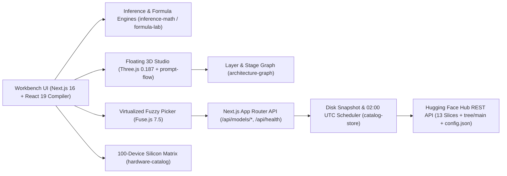

<div align="center">

```
███╗   ███╗ ██████╗ ███╗   ██╗ ██████╗ ██╗     ██╗████████╗██╗  ██╗
████╗ ████║██╔═══██╗████╗  ██║██╔═══██╗██║     ██║╚══██╔══╝██║  ██║
██╔████╔██║██║   ██║██╔██╗ ██║██║   ██║██║     ██║   ██║   ███████║
██║╚██╔╝██║██║   ██║██║╚██╗██║██║   ██║██║     ██║   ██║   ██╔══██║
██║ ╚═╝ ██║╚██████╔╝██║ ╚████║╚██████╔╝███████╗██║   ██║   ██║  ██║
╚═╝     ╚═╝ ╚═════╝ ╚═╝  ╚═══╝ ╚═════╝ ╚══════╝╚═╝   ╚═╝   ╚═╝  ╚═╝
```

### **LOCAL AI INFERENCE CALCULATOR & 3D ARCHITECTURE STUDIO**

*Precision VRAM telemetry, real-time Hugging Face Hub intelligence, floating WebGL neural flows, and trillion-scale memory modeling — engineered in Soft UI Evolution.*

<p>
  
  
  
  
  
</p>

</div>

---

## Core Systems Overview

### 01 · Live Hugging Face Registry & LocalAI Synthesizer
- **13-Slice Ecosystem Sync**: Server startup and a nightly **02:00 UTC** scheduler ([`src/instrumentation.ts`](src/instrumentation.ts), [`src/lib/catalog-store.ts`](src/lib/catalog-store.ts)) pull curated slices (`text-generation`, `gguf`, `mlx`, `image-text-to-text`, `text-to-image`, trending models, and top quantization maintainers) via [`src/lib/hf-client.ts`](src/lib/hf-client.ts) into an atomic JSON disk cache.
- **Full-Height Virtualized Fuzzy Picker**: Weighted `Fuse.js` fuzzy matching paired with debounced live Hub search (`/api/models/search`) renders **100% of synced models** inside a `ResizeObserver`-measured full-height virtualized window (~13–19 live DOM rows regardless of catalog size).
- **Deep Repo & Config Inspection**: On model selection (`/api/models/[...repoId]`), resolves exact shard sizes from `/tree/main`, parses `config.json` (including multimodal `text_config` and GGUF quant mappings), and outputs ready-to-run **`LocalAI model.yaml`** snippets.

### 02 · 100-Device AI Silicon Catalog & Supported-Only Fit Matrix
- **Complete Market Coverage ([`src/lib/hardware-catalog.ts`](src/lib/hardware-catalog.ts))**: Profiles **100 accelerators** across **Apple Silicon** (`M1` → `M5 Ultra 512 GB @ 1,200 GB/s` with adjustable macOS wired GPU allocation ratio), **NVIDIA** (`RTX 2080 Ti`–`5090`, `RTX PRO 6000 Blackwell`, `DGX Spark`, `L4`, `L40S`, `A100`, `H100`, `H200`, `B200`, `GB200`), **AMD** (`RX 6800 XT`–`9070 XT`, `PRO W7800/W7900`, `Ryzen AI Max+ 395 / Strix Halo`, `Instinct MI210–MI350X`), and **Intel** (`Arc B580/A770/Pro B60`, `Gaudi 3`).
- **Strict Fit Enforcement**: Selecting any device and dialing Quantization or Context Window automatically **hides incompatible or OOM models**, sorts by downloads/decode speed/params/headroom, and opens a clickable **Device Parameter Inspector** ([`DeviceDetailModal.tsx`](src/components/DeviceDetailModal.tsx)).

### 03 · Floating 3D Architecture Studio & Step-by-Step Word Flow
- **Soft UI Ceramic Pipeline ([`ArchitectureModal3D.tsx`](src/components/ArchitectureModal3D.tsx))**: Renders Dense Transformers, Sparse MoE, Multimodal VLMs, and Diffusion pipelines as rounded ceramic `RoundedBoxGeometry` blocks auto-framed via `THREE.Box3` with no cluttering platform, pooled geometries/materials, `InstancedMesh` flow orbs, pause/visibility throttling, and full WebGL resource disposal on unmount.
- **Interactive Prompt Bar & Autoregressive Trace ([`src/lib/prompt-flow.ts`](src/lib/prompt-flow.ts))**: Enter any sentence (`Why is the sky blue?`, `How does AI run on Mac?`, etc.) and trace real subword tokens gliding across 3D stages during **Parallel Prefill**, populating the **Live KV Cache Bank**, evaluating **Top-4 Softmax probabilities**, and looping tokens back through **Autoregressive Decode** to stream the answer word-by-word.
- **Clickable Layer X-Ray ([`src/lib/architecture-graph.ts`](src/lib/architecture-graph.ts))**: Click any stage block in 3D or scrub `Layer 1..N` to inspect per-layer weights, KV cache consumption, attention-vs-FFN split, FLOPs/token, and ordered forward-pass kernels (`RMSNorm`, `W_q + RoPE`, `W_k/W_v + KV Append`, `Attention + W_o`, `SwiGLU / MoE Experts`, `Residual Add`).

### 04 · Interactive Context Window & Memory Formula Lab (`/help`)
- **Sub-Billion to Multi-Trillion Simulator ([`src/lib/formula-lab.ts`](src/lib/formula-lab.ts), [`AIHardwareHelpView.tsx`](src/components/AIHardwareHelpView.tsx))**: Test **`0.1B → 10,000B`** parameters across **12 weight precisions** (`FP32` down to `BitNet 1.58b` + custom bpw), **Dense vs Sparse MoE** active params, **5 attention engines** (`MHA`, `GQA 4:1`, `GQA 8:1`, `MQA`, `DeepSeek MLA`), manual layer/head overrides, **`128 → 10M`** token contexts, and multi-GPU clusters with live substituted equations and interactive scaling sweep tables.

### 05 · Soft UI Evolution, Zero-Lag Architecture & Anti-Scraping Shield
- **Tactile Accessibility**: Light (`#F0F4F8`) & Dark (`#1A202C`) themes at **95% viewport width**, single-level inset wells (`surface > well`), WCAG AA contrast ratios, `3px` `:focus-visible` outlines, `prefers-reduced-motion` support, procedural seeded SVG logo generator ([`GeneratedLogo.tsx`](src/components/GeneratedLogo.tsx)), and zero-rerender DOM RAF roaming companion `M-01` ([`RoamingMascot.tsx`](src/components/RoamingMascot.tsx)).
- **Zero-Lag Optimization**: Code-splits Three.js (`next/dynamic`), mounts modals only when open, defers expensive recomputations with `useDeferredValue` + `startTransition`, activates Next.js **React Compiler**, and prevents cascading renders via `useSyncExternalStore`.
- **Anti-Bot / Anti-Scraping Defense**: Strict `Disallow: /` across [`public/robots.txt`](public/robots.txt), global `X-Robots-Tag` HTTP headers ([`next.config.ts`](next.config.ts)), and restrictive `robots` metadata ([`src/app/layout.tsx`](src/app/layout.tsx)).

---

## System Architecture



---

## Quickstart

### Prerequisites
- **[Bun](https://bun.sh/)** (`>= 1.3`) & **[Node.js](https://nodejs.org/)** (`>= 20.9`, **Node 22 LTS** recommended for Next.js 16 standalone runtime)

### Local Development
```bash
bun install
bun run dev
```
Open **`http://localhost:3000`** (or jump straight to **`http://localhost:3000/help`** for the Interactive Formula Lab & Hardware Guide).

### Production Standalone Build
```bash
bun run build
mkdir -p .next/standalone/.next && cp -r .next/static .next/standalone/.next/ && cp -r public .next/standalone/
PORT=3000 HOSTNAME=0.0.0.0 node .next/standalone/server.js
```

### Multi-Arch Docker & GHCR
Images are automatically published via [`.github/workflows/docker-ghcr.yml`](.github/workflows/docker-ghcr.yml) to **`ghcr.io/chakarai1234/inference_calculator:latest`** for both **`linux/amd64`** and **`linux/arm64`**.

#### Docker Compose (Recommended)
Deploy using [`docker-compose.yml`](docker-compose.yml) (pulls `ghcr.io/chakarai1234/inference_calculator:latest` with persistent Hugging Face snapshot storage and live healthcheck):
```bash
docker compose up -d
```

#### Docker CLI
```bash
docker run -d --name monolith -p 3000:3000 ghcr.io/chakarai1234/inference_calculator:latest
```

Or build the 3-stage image locally (`oven/bun:1-slim` deps → `node:22-bookworm-slim` builder → `node:22-bookworm-slim` standalone runtime):
```bash
docker buildx build --platform linux/amd64,linux/arm64 -t monolith:local .
```

---

## API & Environment Reference

| Route | Method | Description |
|---|---|---|
| `/api/health` | `GET` | Server uptime, active catalog count, cache source (`live` / `cache` / `seed`), next refresh UTC timestamp |
| `/api/models/catalog` | `GET` | Full deduplicated catalog snapshot |
| `/api/models/search?q=...` | `GET` | Live Hugging Face Hub query (`limit=80`) normalized for instant inference estimation |
| `/api/models/refresh` | `POST` | Manual catalog resync trigger (`x-monolith-ui: 1`) |
| `/api/models/[...repoId]` | `GET` | Deep inspection of `/tree/main` file shards, GGUF quants, and `config.json` parameters |
| `/robots.txt` | `GET` | Strict `Disallow: /` directives for all bots & AI scrapers |

| Variable | Default | Purpose |
|---|---|---|
| `PORT` | `3000` | HTTP bind port |
| `HOSTNAME` | `0.0.0.0` | HTTP bind interface |
| `CATALOG_CACHE_PATH` | `/app/data/hf-catalog.json` (Docker) / `.cache/hf-catalog.json` (local) | Persistent disk location for synced HF snapshots |
| `CATALOG_REFRESH_HOUR` | `2` | UTC hour (`0–23`) for automated nightly Hugging Face catalog refresh |
| `HF_TOKEN` | _(optional)_ | Hugging Face Hub Bearer token for gated repos & higher API rate limits |
| `NEXT_DIST_DIR` | `.next` | Optional isolated output directory override |

---

## Project Layout

```text
Dockerfile / docker-compose.yml           # Multi-arch build & GHCR :latest Compose stack
.github/workflows/                        # CI verify & amd64/arm64 GHCR publisher
public/robots.txt                         # Site-wide Disallow: / anti-scraping directives
src/
├── app/
│   ├── api/health/route.ts               # Liveness & catalog sync telemetry
│   ├── api/models/[...repoId]/route.ts   # Repo tree + config.json inspector
│   ├── api/models/{catalog,refresh,search}/route.ts
│   ├── help/page.tsx                     # Standalone Formula Lab & Hardware Guide route
│   ├── globals.css                       # Soft UI Evolution Light/Dark design tokens
│   └── layout.tsx                        # Fonts, pre-hydration theme script & anti-bot meta
├── components/
│   ├── WorkbenchShell.tsx                # Code-split shell, nav, modal orchestration
│   ├── ModelCalculatorTab.tsx            # Model specs, quant/context controls, LocalAI YAML
│   ├── ModelFuzzyPicker.tsx              # Full-height virtualized Fuse.js + Hub search list
│   ├── HardwareCompatibilityTab.tsx      # 100-device Silicon catalog + strict OOM filter
│   ├── ArchitectureModal3D.tsx           # Floating Three.js 3D Studio + prompt word trace
│   ├── DeviceDetailModal.tsx             # Clickable CPU/GPU/VRAM parameter sheet
│   ├── AIHardwareHelpView.tsx            # Trillion-scale Formula Lab & hardware reference
│   ├── GeneratedLogo.tsx / RoamingMascot.tsx / ThemeProvider.tsx / ThemeToggleButton.tsx
└── lib/
    ├── hf-client.ts / catalog-store.ts / hf-fallback-seed.ts
    ├── hardware-catalog.ts / inference-math.ts
    ├── architecture-graph.ts / prompt-flow.ts / formula-lab.ts
    └── __tests__/                        # Bun unit tests across math, 3D, flow & formula lab
```

---

## Verification

```bash
bun test             # Unit tests across inference math, 3D layers, prompt flow & trillion-scale lab
bun run typecheck    # TypeScript strict check (tsc --noEmit)
bun run lint         # ESLint 10 + Next.js Core Web Vitals + React Compiler rules
bun run build        # Next.js 16.4.6 Turbopack + standalone bundle
```
